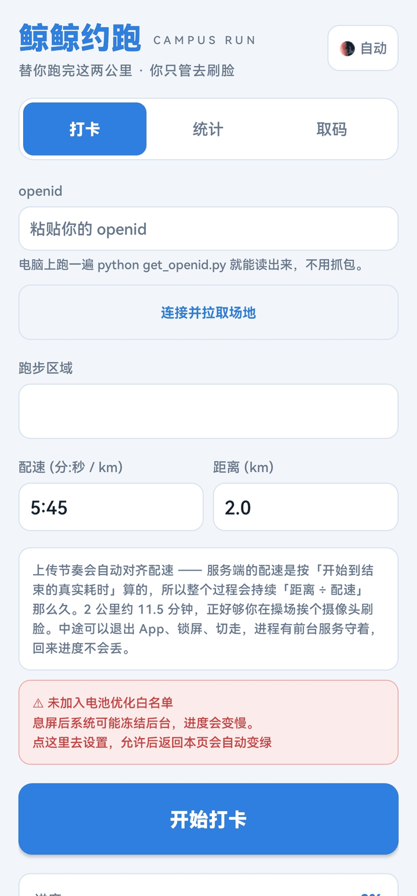
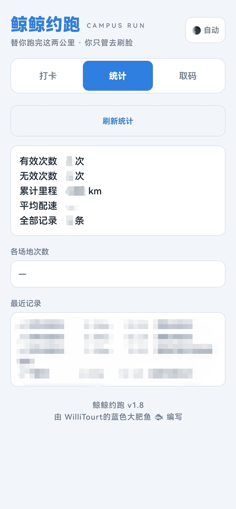
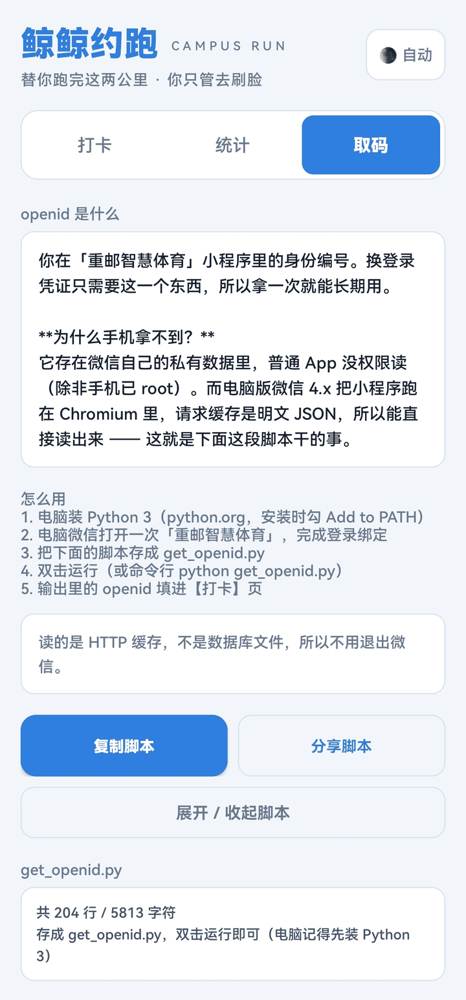
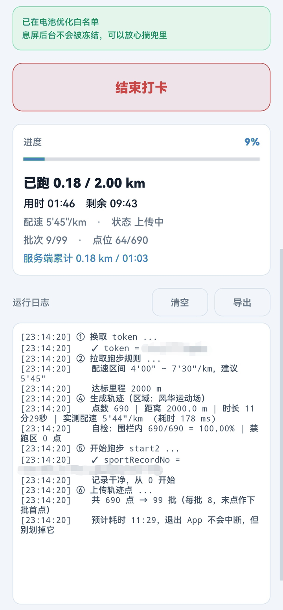
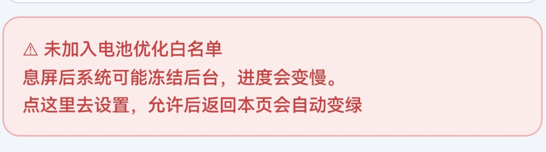

# 鲸鲸约跑

> 填一次 openid，它自己把 2 公里跑完。你只负责去摄像头下面走一趟。

微信小程序「重邮智慧体育」的打卡工具，**安卓单机版**。
不申请定位权限，不连服务器，不需要登录，不给别人用。


**当前版本 v1.9.0** · [变更记录](CHANGELOG.md) · [技术细节](#六技术细节) · [文件说明](#七文件说明)

---

## 一、它长什么样

主页只有打卡，其余全部收进右上角【设置】：

| 打卡（主页） | 统计（设置页） | 取码（设置页） |
|---|---|---|
|  |  |  |

> 截图是 v1.8 拍的。v1.9.0 重构了导航：主页只留打卡，openid 移进设置页，
> 右上角是两个小图标（日志 / 设置）。总体观感不变。

跑起来是这样：

| 运行日志 |
|---|
|  |

---

## 二、怎么用

一共四步。**第 1、2 步只需要做一次**，以后每次跑只要第 3、4 步。

### 第 1 步：拿 openid（只做一次）

openid 是你在小程序里的身份编号。**换登录凭证只需要这一个东西**，
所以拿一次就能一直用，不用密码、不用验证码。

它存在电脑版微信的缓存里。手机拿不到（存在微信私有目录，除非手机 root），
所以这一步**要找一台电脑**：

1. 电脑装 [Python 3](https://www.python.org/downloads/)（安装时勾上 **Add to PATH**）
2. 电脑微信打开一次「重邮智慧体育」，完成登录绑定
3. 把 [`get_openid.py`](get_openid.py) 存到电脑上，双击运行
4. 输出里的 openid 抄下来

```
找到 1 个身份：

  [1] openid
      oXXXXXXXXXXXXXXXXXXXXXXXXXXX

把这个 openid 填进 App 的【打卡】页即可
```

> **懒得传文件？** App 的【取码】页里有同一份脚本，
> 点「分享脚本」可以直接当 `.py` 文件发到微信文件传输助手，电脑上双击就能跑。
>
> **不用退出微信。** 读的是 HTTP 缓存不是数据库文件，微信开着也能读。

### 第 2 步：设置一次电池白名单（重要）

安卓的深度省电（Doze）会**冻结后台的 CPU 和网络**，连 CPU 唤醒锁都会忽略。
不设置的话，你把手机揣兜里息屏，进度会慢得像爬 —— 只有「用时」在涨。

打开 App，配速/距离下面有一条**红色**的提示：



点它 → 系统弹窗问「允许应用始终在后台运行吗」→ 选**允许** →
按返回键回到 App，那条会自己变成**绿色**：


**只用设置一次。**

### 第 3 步：填参数开跑


| 填什么 | 填多少 |
|---|---|
| openid | 第 1 步拿到的 |
| 配速 | **5:45**（规则要求 4'00" ~ 7'30"，取中间最稳） |
| 距离 | **2.0**（规则要求 2000 米） |
| 场地 | 你实际要去的那个（风华运动场 / 太极运动场 / 宁静苑） |
| 平均配速容差 | 留默认 **20**（秒/公里）即可 |

> 点【连接并拉取场地】如果连不上服务器，会直接弹一个「无法连接到服务器」的提示框，
> 告诉你去检查网络，而不是默默留一个空场地列表。

然后——

> **点「开始」之前，人先进操场。**
> 然后点开始，把手机揣兜里，**挨个摄像头走过去**。

自动打卡过程中：

- 可以退出 App、锁屏、切到别的应用 —— **进度不会丢**（前台服务守着）
- 通知栏有实时进度，下拉就能看
- **别在后台划掉它**（从最近任务里划走会终止）

回到 App 会看到实时仪表盘：


```
进度        XX%
已跑        XXXX / XXXX km
用时 XX:XX  剩余 XX:XX
配速 X'XX"/km · 状态 上传中
批次 XX/99 · 点位 XXX/XXX
服务端累计 XXXX km / XX:XX
```

跑满 2 公里会**自动结束**，不用手动点。

### 第 4 步：看结果

点右上角【设置】→「成绩统计」→ 点「刷新」：


看到 `✓` 就成了。

> 服务端会做两个判定：
> 1. **配速 / 里程** —— 工具保证达标
> 2. **人脸检测** —— `锻炼时间内无跑步检测` / `跑步检测过少`
>
> 第 2 条**只能靠你本人到场**。小程序里根本不调相机，人脸比对是在操场摄像头里做的。
> 这一点无解，工具也绕不过去。

---

## 三、常见问题

<details>
<summary><b>手机能不能直接拿 openid？</b></summary>

不能。openid 存在微信自己的私有数据目录里，普通 App 没权限读（除非手机已 root）。
电脑版微信 4.x 把小程序跑在 Chromium 里，请求缓存是**明文 JSON**，所以能直接读。
这就是为什么必须借一台电脑，以及为什么那个商业采集器也要求用电脑。
</details>

<details>
<summary><b>脚本说「没找到 openid」？</b></summary>

按顺序检查：

1. 电脑微信里**打开过一次**「重邮智慧体育」并完成绑定 —— 没打开过就没缓存
2. 换个账号试 —— 脚本只找**这台电脑上登录过的微信号**
3. 微信开着也没关系（v1.8 起用 `CreateFileW` 绕过了文件锁，之前要退出微信）
</details>

<details>
<summary><b>进度条不走 / 只有用时在涨？</b></summary>

第 2 步的电池白名单没设。去设置成绿色再跑。
</details>

<details>
<summary><b>配速设多少？</b></summary>

**5:45**。服务端规则是 `minPace = 4.0` `maxPace = 7.5`，也就是 4'00" ~ 7'30" 之间。
取中间段最保险，别贴着边界设。
</details>

<details>
<summary><b>能设更长的距离吗？</b></summary>

规则要求 2000 米，跑满 2 公里就够。设更长没有意义，设更短不达标。
</details>

<details>
<summary><b>为什么不用模拟定位 / 改手机 GPS？</b></summary>

**因为根本不需要。** 逆向之后发现小程序是纯客户端信任架构 ——
它自己把轨迹点收集起来直接 POST，服务端不回采、无法验证真伪，
连 `isValid` 都是客户端 JS 算的。

所以直接在 App 里构造 HTTP 请求就行，**完全不用碰手机定位**。
（最开始的 iOS / Android 定位注入方案因此全部作废，代码留在
[`android/`](android/) [`ios/`](ios/) 里当参考。）
</details>

<details>
<summary><b>会不会被发现？</b></summary>

服务端能看到的只有你 POST 上来的点和时间戳。工具做了这些：

- 配速取区间中段，不贴边
- 每个点都验证在场地多边形内（100%）
- 轨迹绕开禁跑区（`jpq`）
- 加了模拟真实 GPS 的低频漂移噪声，不是完美折线
- 时间戳连续递增，上传节拍和真实耗时对齐

但说实话：**人脸那关没过去，一切都白搭。**
</details>

---

## 四、你需要准备什么

| 东西 | 说明 |
|---|---|
| 一台安卓手机 | Android 7.0+，HarmonyOS 4.0 实测可用 |
| 一台电脑 | 只为了跑一次 `get_openid.py`（拿完 openid 就不用了） |
| 电脑版微信 | 在这台电脑上打开过一次「重邮智慧体育」 |
| 你本人 | 去操场摄像头下面走一趟 |

---

## 五、自己编译

```bash
cd android-app
./gradlew assembleRelease        # Windows 用 gradlew.bat
```

需要 **JDK 17** + **Android SDK 34**。产物在 `app/build/outputs/apk/release/`。

详细的构建说明、工具链摆放、踩坑记录见 **[`android-app/README.md`](android-app/README.md)**。

---

## 六、技术细节

<details>
<summary><b>点开看完整链路（含接口、算法、实测结论）</b></summary>

### 结论：纯客户端信任架构

| 你以为的 | 实际的 |
|---|---|
| 小程序采集真实 GPS，服务端校验 | 收集起来直接 POST，**服务端不回采** |
| 有请求签名 / 加密，要逆向算法 | **完全没有签名**，明文 JSON |
| 轨迹有效性服务端判定 | `isValid` / 区域判定 / 补点 **全是客户端 JS 算的** |

而且 token 只要一个 openid 就能换，`wxCode` 传空串就行：

```js
// 反编译出来的 token 刷新分支
var openid = wx.getStorageSync("openid");
return openid != null && openid !== ""
  ? (res, rej) => doCheckBinding(res, rej, "")      // ← wxCode 传空
  : (res, rej) => wx.login({ success: r => doCheckBinding(res, rej, r.code) });
```

### 请求流程

```
① openid
     ↓
② GET  /new_wxapp/wxUnifyId/checkBinding?wxCode=&openid=<OPENID>&phoneType=PC_Windows
     ← { isBind:"true", token:"..." }
     ↓
③ GET  /new_wxapp/setting/getRule                     → maxPace / minPace
   GET  /new_wxapp/place/getPlayground                → 可跑步场地列表
   GET  /new_wxapp/area/getAllArea                    → 区域多边形 + placeCode
   GET  /new_wxapp/areaFunc/getFunc                   → 区域功能字典
     ↓
④ POST /new_wxapp/sportRecord/sport/start2            → sportRecordNo
     ↓
⑤ POST /new_wxapp/sportRecord/point/saveListByNo      ×N
     每批 8 点，并把上一批的末点作为下一批的首点
     ↓
⑥ POST /new_wxapp/sportRecord/sport/end/<sportRecordNo>
```

全部请求 `header: { token }`，**没有任何签名**。

### 几个实测踩明白的点

| 发现 | 说明 |
|---|---|
| `jpq` 不是人脸区 | 一开始以为是「人脸区」，实测 `/areaFunc/getFunc` 给出字典后确认是**禁跑区**。里面的点 `isValid="2"`，`calcDistance` 返回 0，**不计入里程** |
| 图片上传接口是摆设 | `/sportRecord/mobile/uploadImg` 是用来传人脸图的，但小程序**从来不调**。人脸比对在物理摄像头上做 |
| 服务端复用未结束的记录 | `start2` 会把上次没 `end` 的记录原样还回来，导致进 App 就看到旧进度 |
| 服务端按点的 `collectTime` 算时长 | 中途实测：183 个点 → 服务端报 `timeConsuming = 182`，正好是 `collectTime` 跨度。所以**上传节拍必须和真实时间对齐**，一把梭全发会被判无效 |
| 有测试残留场地 | `placeCode` 为 `00001 上海成` / `00002 石桥铺` 的是开发测试数据，要过滤掉 |

### 轨迹算法

[`track_engine.py`](track_engine.py) / `TrackGen.kt` 按配速生成「像人跑出来的」轨迹：

- **配速标定**：采样点数由「配速 × 距离」锁死，再二分反解地面速度，
  保证输出轨迹的**实测配速等于目标配速**（否则噪声会把距离撑长 15%）
- **配速温和起伏**（v1.9.0）：把匀速拆成有快有慢 —— 疲劳（整场）+ 地形（分钟级）
  + 步频（十几秒级）三种时间尺度叠加，并叠入约 7% 时长的短暂停顿，
  权重归一化到均值 1。**不改变总时长和总里程**，因此不影响达标
- **平均配速钳制**（v1.9.0）：生成后校验实测平均配速是否在「目标 ± 容差」内，
  越界就微调采样点数重算，保证不飘出达标区间
- **汇报字段反推**（v1.9.0）：`speed` / `bearing` 由最终坐标反算，和轨迹严格自洽
- **路线有机化**：矩形折线 → 低频正弦扰动 + 循环滑动平均磨圆直角，航向连续变化
- **GPS 噪声**：AR(1) 相关噪声，模拟真实低频漂移
- **坐标系**：内置 WGS84 ↔ GCJ02 双向转换（小程序用 GCJ02，**必须转**）
- **围栏内缩 + 越界钳制**：多边形朝质心内缩 + 有机化，个别被噪声顶出边界的点
  再由 `clampToFence()` 拉回来，保证 100% 在围栏内且绕开禁跑区

实跑验证：

```
配速 3:30  实测 3'29"      配速 10:00 实测 9'59"
配速 5:30  实测 5'29"      配速 14:00 实测 13'59"
配速 7:45  实测 7'44"
```

配速起伏实测（风华运动场 2000m，15 秒滚动窗口）：分段配速约 **4'10" ~ 7'59"**，
2 公里约 2~3 次短暂停顿。总时长和总里程与匀速完全一致 —— 形态只决定速度怎么分配。

离线验证脚本：[`refs/verify_pace_profile.py`](refs/verify_pace_profile.py)（288 组合压测）。

### 跑步规则（实测）

```
raceMile = 2000.0 m    minPace = 4.0    maxPace = 7.5
```

三个可跑场地：

| placeCode | 场地 | 围栏 |
|---|---|---|
| T1001 | 风华运动场 | 20 顶点 / 周长 564m / 1 处禁跑区 |
| T1005 | 太极运动场 | 5 顶点 / 周长 770m / 1 处禁跑区 |
| T1014 | 宁静苑 | 6 顶点 / 周长 554m / 无禁跑区 |

**完整逆向报告见 [`refs/FINDINGS.md`](refs/FINDINGS.md)**
（含 V1MMWX 包体解密、20+ 接口全表、采集器分析、实机验证日志）。

</details>

---

## 七、文件说明

| 文件 | 作用 |
|---|---|
| [`android-app/`](android-app/) | 📱 **成品 App** —— 源码 + 构建说明 |
| [`get_openid.py`](get_openid.py) | 本地提取 openid（零解密、不联网） |
| [`wecat_run.py`](wecat_run.py) | 命令行版客户端（电脑上跑，不用装 App） |
| [`track_engine.py`](track_engine.py) | 轨迹引擎 Python 参考实现 |
| [`CHANGELOG.md`](CHANGELOG.md) | 版本变更记录 |
| [`refs/FINDINGS.md`](refs/FINDINGS.md) | 完整逆向报告 |
| [`refs/verify_pace_profile.py`](refs/verify_pace_profile.py) | 配速形态离线验证（288 组合压测） |
| [`refs/wxapkg_unpack.py`](refs/wxapkg_unpack.py) | V1MMWX 包体解密 + 解包（纯 Python AES） |
| [`refs/clear_stale.py`](refs/clear_stale.py) | 清理服务端挂着的未结束记录 |
| [`android/`](android/) · [`ios/`](ios/) · [`api/`](api/) | 早期作废的定位注入方案，留作参考 |

### 界面结构

主页只有打卡，其余在右上角【设置】：

```
主页                     设置页
├── openid 输入          ├── 主题（跟随系统 / 深色 / 浅色）
├── 连接并拉取场地        ├── 成绩统计
├── 跑步区域             ├── 取码（openid 说明 + 提取脚本）
├── 配速 / 距离          ├── 使用教程
├── 平均配速容差          ├── 说明信息
├── 电池白名单提示        └── 开源仓库
├── 开始 / 结束打卡
├── 实时仪表盘
└── 运行日志
```

### 命令行版（不想装 App 的话）

```bash
pip install requests

# 先探测：打出配速规则、场地列表、区域多边形、历史记录
python wecat_run.py probe --openid <OPENID>

# 干跑看请求
python wecat_run.py run --openid <OPENID> --place 0 --pace 5:45 --dist 2.0 --dry-run

# 实跑（--realtime 按真实配速节流上传，必须开）
python wecat_run.py run --openid <OPENID> --place 0 --pace 5:45 --dist 2.0 \
       --validate-region --realtime --live
```

---

## 许可

[MIT](LICENSE) —— 随便用、改、再发，但**不提供任何担保**。

> 本项目仅供个人学习与安全研究。逆向、接口调用、自动打卡均由使用者自行发起，
> 使用者需自行承担一切后果（包括但不限于账号处罚、成绩判定、校纪校规处理）。
> 作者不对任何使用后果负责。

---

> 作者：**WilliTourt的蓝色大肥鱼 🐟**
